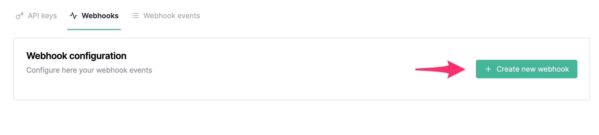
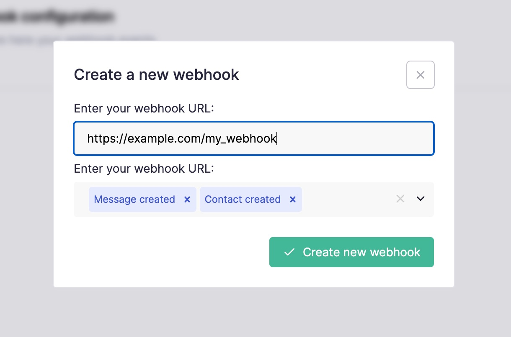
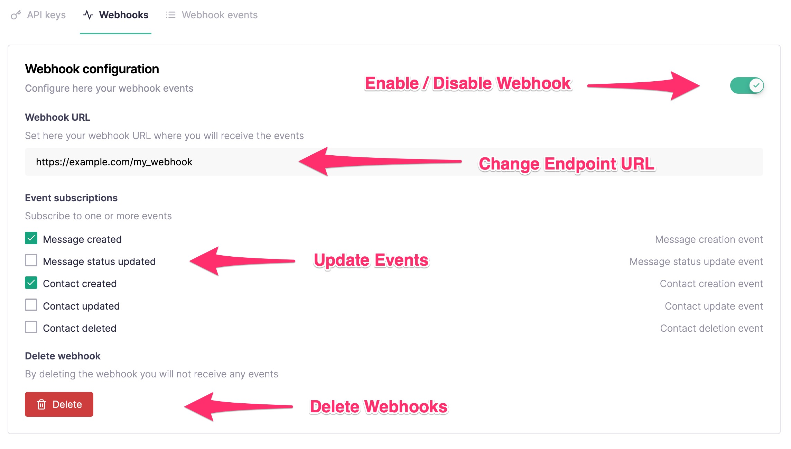

# Introduction

Callbell API provides **HTTP Webhooks** for the most common application events:

- **Message events**
- **Message notification status events**
- **Contact events**
- **Conversation events**
- **Agent events**
- **Team events**
- **Call events**

## How to subscribe to events

:::info
This can be done also programmatically from [WebhooksEndpoint](./../webhooks_api/introduction.md)
:::

On your Callbell dashboard navigate to the [**"API Settings"**](https://dash.callbell.eu/settings/api_settings/webhooks) section and click on the "Webhooks" tab:

In the URL field add your endpoint URL (e.g. `https://myapp.com/callbell_endpoint`) and select the events you want to get subscriptions for:

:::info
Make sure to also **include** the protocol (`http` or `https`) inside your webhook endpoint:

✅ **Good**: `https://www.myexample.com`

❌ **Bad**: `www.example.com`
:::

After clicking "Create new webhook" you should receive a success notification. You can always edit back the Webhook events in a later stage:

:::caution
Callbell doesn't support `localhost` as webhook URL. If you need to debug a local application use instead a service to expose your local dev environment like [Ngrok](https://ngrok.com).
:::

:::tip
Callbell can sign every webhook request with a secret that belongs to your webhook. See [Verifying signatures](./signatures.md) to turn it on and to check that a request comes from Callbell.
:::

## Delivery and retries

Callbell sends each event to your endpoint as an HTTP `POST` request with a JSON body. Callbell does not run separate connection checks against your endpoint, so it judges the endpoint only by how it responds to real event deliveries.

A delivery succeeds when your endpoint answers with any `2xx` status code. Callbell does not read the response body, so you can return an empty body.

A delivery attempt fails when your endpoint answers with a status code outside the `2xx` range, when Callbell cannot connect to it (for example because of a DNS, connection or TLS error), or when the request times out. Callbell waits up to 5 seconds to open the connection to your endpoint, and up to 10 seconds each to send the request and to receive the response.

When a delivery attempt fails, Callbell retries the same event with an exponential backoff, which means that the wait between two attempts grows after each attempt. Callbell makes up to 5 delivery attempts for each event, and the last attempt happens about 6 to 7 minutes after the first one. If all 5 attempts fail, Callbell drops the event and does not send it again later, even after your endpoint recovers. Because a request that timed out is also retried, your endpoint can receive the same event more than once, so make sure that processing an event twice has no unwanted effect.

To recover the events that Callbell dropped, call [GET /webhooks/events](./../webhooks_api/events.md) with the `status=failed` filter. Each failed event has `success: false` and includes its payload, together with the response code and body that Callbell received or the error that prevented the delivery.

Your endpoint is **failing continuously** while Callbell has made no successful delivery to it and no more than 1 hour has passed between one failed attempt and the next. This failing period starts with the first failed attempt. Any successful delivery ends it. A failed attempt that comes more than 1 hour after the previous failed attempt starts a new failing period, so hours without any traffic to your endpoint do not count as failing time. Callbell uses this failing period to decide when to send the warning email and when to disable the webhook.

## Email notifications

Callbell sends two kinds of email about a webhook that keeps failing:

- **Warning email**: when your endpoint has been failing continuously for 15 minutes, Callbell sends a warning email to the account owner. If the webhook has a secondary email address, Callbell sends the same warning to that address too. You can set the secondary email address in the "Webhooks" tab of the [**"API Settings"**](https://dash.callbell.eu/settings/api_settings/webhooks) section. Callbell sends at most one warning email per webhook every 24 hours, and this limit starts over when the webhook is re-enabled.
- **Webhook disabled email**: when Callbell disables the webhook, it sends an email to the account owner only. The secondary email address does not receive this email.

## Disabled webhooks

Callbell disables the webhook when an event fails all of its 5 delivery attempts and your endpoint has been failing continuously for at least 6 hours. Every kind of failed attempt counts, including a timeout. Because any successful delivery ends the failing period, isolated failures between successful deliveries never disable the webhook.

While the webhook is disabled, Callbell does not deliver any event to your endpoint, and events that happen during that time are not sent later.

To re-enable the webhook, turn it back on in the "Webhooks" tab of the [**"API Settings"**](https://dash.callbell.eu/settings/api_settings/webhooks) section, or call [POST /webhooks/subscribe](./../webhooks_api/subscribe.md). Fix the problem with your endpoint first, otherwise the webhook can be disabled again.
